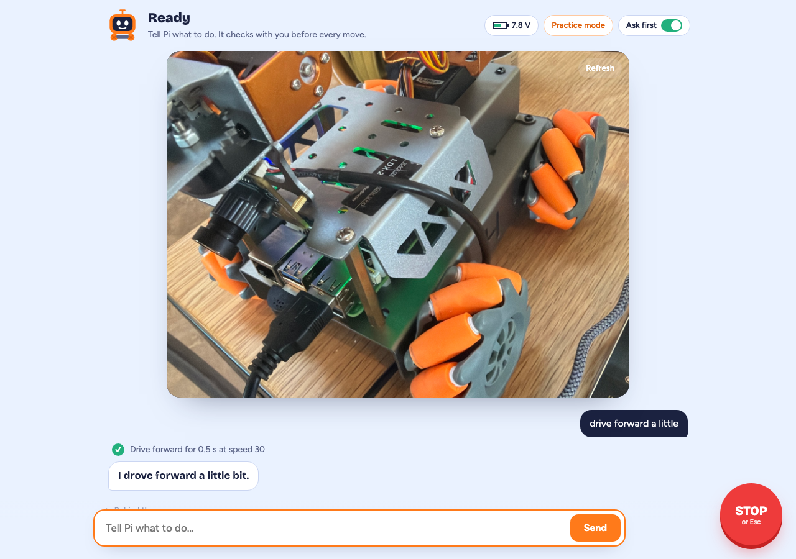
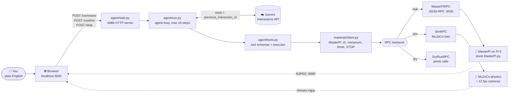
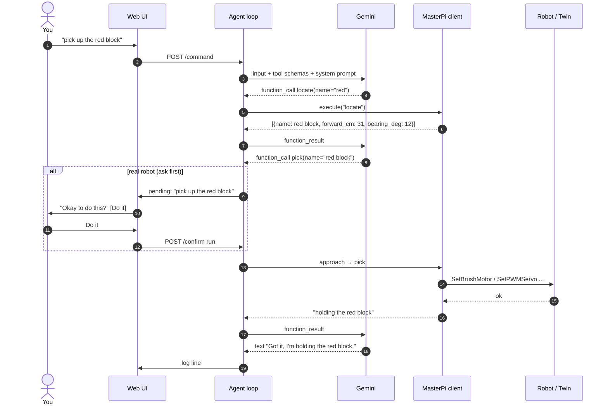
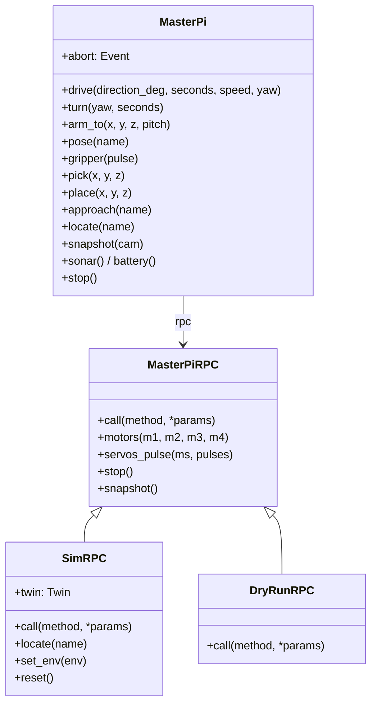
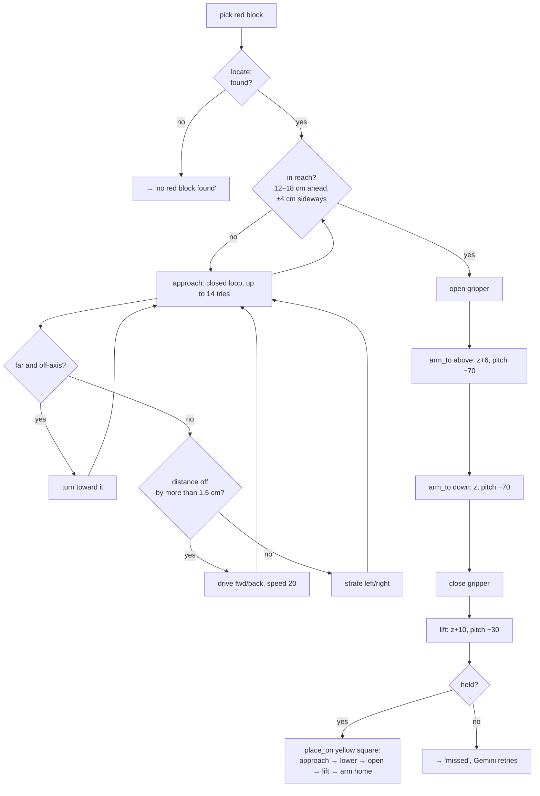
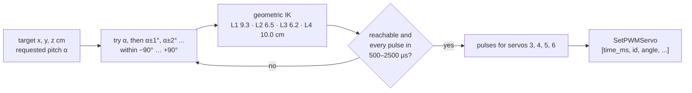
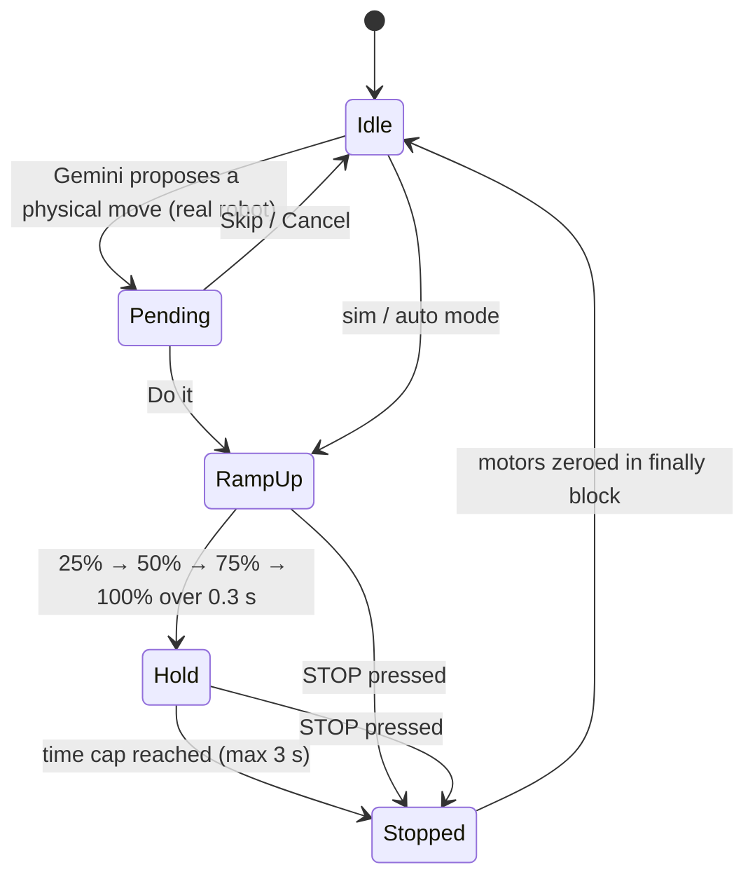
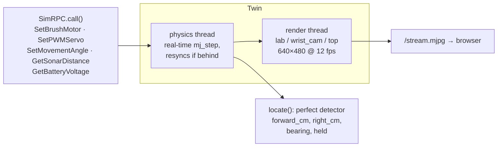
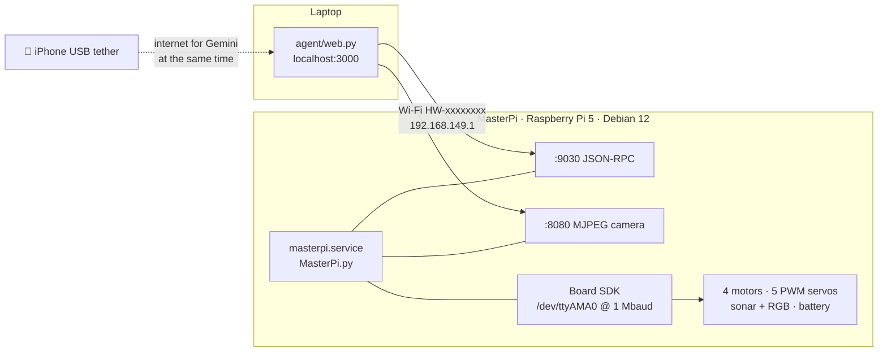

<div align="center">

# 🤖 masterpi-bridge

### Tell a $300 robot what to do in plain English. Gemini plans it, your laptop runs it, and the robot (or its MuJoCo twin) does it.

**One codebase. Three backends. Zero code changes between simulation and the real robot.**

[](#quick-start)
[](https://github.com/techadnank9/masterpi-mujoco)
[](#how-the-agent-thinks)
[-FF7A00)](#the-real-robot)
[](#tests)
[](#project-layout)



*Real robot, real camera feed. "drive forward a little" → one confirmed move → done.*

</div>

---

## Why this exists

The Hiwonder MasterPi is a great little robot: a mecanum base, a 4-joint arm, a gripper, a camera
and a sonar on a Raspberry Pi 5. Out of the box you drive it with an app and preset buttons.

**masterpi-bridge turns it into an agent.** You type *"put the red block on the yellow square"* and:

1. 🧠 **Gemini** breaks the request into tool calls (`locate`, `approach`, `pick`, `place_on`, `drive`, `arm_to`, `look`, ...)
2. 💻 **Your laptop** runs the loop, computes inverse kinematics and mecanum wheel mixing, and enforces safety limits
3. 🦾 **The robot** (or its physics twin) executes stock JSON-RPC calls. Nothing needs installing on the robot.

Verified end to end in simulation:

| Request | Gemini did | Time |
|---|---|---|
| *"stack red on the yellow square, then blue on red"* (one sentence, no hints) | locate → pick red → place on yellow → pick blue → place on red | **112 s** |
| *"put green block on red"* | locate → approach → pick → place_on | **44 s** |

---

## Table of contents

- [Quick start](#quick-start)
- [Architecture](#architecture)
- [How the agent thinks](#how-the-agent-thinks)
- [One interface, three backends](#one-interface-three-backends)
- [Pick and place, step by step](#pick-and-place-step-by-step)
- [The arm: IK on the laptop](#the-arm-ik-on-the-laptop)
- [The base: mecanum mixing](#the-base-mecanum-mixing)
- [Safety model](#safety-model)
- [The web app](#the-web-app)
- [The simulation](#the-simulation)
- [The real robot](#the-real-robot)
- [Reference: tools, CLI, HTTP API, config](#reference)
- [Project layout](#project-layout)
- [Honest limitations](#honest-limitations)
- [Roadmap](#roadmap)

---

## Quick start

```bash
git clone https://github.com/techadnank9/masterpi-bridge.git
git clone https://github.com/techadnank9/masterpi-mujoco.git ~/Documents/masterpi-mujoco   # the robot model
cd masterpi-bridge
pip install requests mujoco pillow numpy
echo "GEMINI_API_KEY=your-key" > .env
python3 agent/web.py --sim          # open http://localhost:3000
```

No robot? That's fine. `--sim` gives you the full experience in a MuJoCo lab with blocks, targets and
four scenes to pick from.

| Mode | Command | What happens |
|---|---|---|
| 🧪 Simulation | `python3 agent/web.py --sim` | MuJoCo twin. Gemini acts without asking. |
| 🤖 Real robot | `python3 agent/web.py` | Hiwonder MasterPi over Wi-Fi. **Every physical move waits for you to tap "Do it".** |
| 🖨️ Dry run | `python3 agent/web.py --dry-run` | No hardware. Prints every RPC call it would send. |
| ⌨️ Terminal | `python3 agent/run.py --sim "put the red block on the yellow square"` | Same agent in a REPL or as a one-shot command. |

---

## Architecture



The important line is the one between `client.py` and the RPC backend. **Everything above it is
identical for the sim and the robot.** The twin speaks the robot's own JSON-RPC method names
(`SetBrushMotor`, `SetPWMServo`, `GetSonarDistance`, ...), so wheel mixing, pulse conversion, IK, the
Gemini tools and the UI are tested against the same code that moves the real hardware.

---

## How the agent thinks



* **Stateful conversation, stateless code.** Each turn sends `previous_interaction_id`, so Gemini keeps
  the context while the laptop keeps no chat history.
* **Errors go back to the model.** If a tool throws, the motors stop and the error text is returned as
  the tool result, so Gemini can try something else.
* **Images are first-class.** `look` returns real JPEG frames from the gripper camera (plus a lab
  overview in sim) as inline images.
* **Hard ceiling.** 16 model steps per command, then the robot stops.
* **Model is configurable.** Default is `gemini-4-argon` with `thinking_level: low`. If a model rejects
  `thinking_level`, the loop retries without it.

---

## One interface, three backends



`SimRPC` and `DryRunRPC` subclass the real client and override only `call()`. A `MasterPi(sim=True)`
and a `MasterPi()` take the same method calls, so a test that passes in the twin exercises the same
code path the robot will see.

---

## Pick and place, step by step

What happens after Gemini calls `pick("red block")` and then `place_on("yellow square")`:



Stacking works the same way: `place_on("blue block")` releases 3 cm higher than on a floor target.

---

## The arm: IK on the laptop

The stock `ArmMoveIk` RPC on the Pi 5 image is broken (it calls an undefined `setPitchRangeMoving`).
Instead of patching the robot, [`masterpi/ik.py`](masterpi/ik.py) ports Hiwonder's own
`InverseKinematics.py` + `ArmMoveIK.py` to the laptop and sends raw servo pulses. **Its output matches
the robot's own pulses exactly.**



Arm frame, in cm, origin at the IK base:

```
            +z (up)
             │   +y (forward)
             │  ╱
             │ ╱
             │╱________ +x (right)
           base
  floor ≈ z −3.5     comfortable reach ≈ 8–18 cm forward
  pitch: 0 = gripper level, −90 = pointing straight down
```

| Servo id | Joint | Notes |
|---|---|---|
| 1 | Gripper | open 1500 µs, closed 2000 µs |
| 3 | Wrist pitch | |
| 4 | Elbow | |
| 5 | Shoulder | |
| 6 | Base yaw | `atan2(y, x)` |
| 2 | — | does not exist on this robot, rejected client side |

Named poses (`home`, `right`, `reach_r`, `reach_l`, `low`) are precomputed pulse sets, so they work
even without IK.

---

## The base: mecanum mixing

[`mecanum_duties()`](masterpi/client.py) is the same math as Hiwonder's
`MecanumChassis.set_velocity`, run on the laptop so the duties can be ramped and capped:

```
vx = speed · cos(direction)      vy = speed · sin(direction)      vp = −yaw · (a + b)
m1 = −(vy + vx − vp)             m2 =  vy − vx + vp
m3 = −(vy − vx − vp)             m4 =  vy + vx + vp              a + b = 67 + 59 mm
```

```
   direction_deg:        90 forward
                            ▲
           180 left  ◀──── ● ────▶  0 right         yaw > 0 = clockwise
                            ▼
                        270 back
```

Gemini sees `forward / back / left / right` plus seconds and speed, about 7 cm/s at speed 20 and 15 cm/s
at speed 40. The client turns that into duty cycles.

---

## Safety model

A robot that takes orders from an LLM needs hard limits that the LLM can't talk its way past. These
are enforced in code, below the model:



| Layer | Guard |
|---|---|
| **Human in the loop** | On the real robot every physical tool call (`drive`, `turn`, `arm_pose`, `arm_to`, `gripper`, `approach`, `pick`, `place_on`) shows one *"Okay to do this?"* card. Read-only tools (`look`, `sonar`, `battery`, `locate`) run freely. |
| **STOP button / Esc** | Sets an abort flag that every move checks every 50 ms, sends `SetMovementAngle -1` **and** zeroes all four motors, cancels the pending card, and resets the Gemini conversation so it can't resume the old plan. |
| **Every drive ends in stop** | `drive()` wraps the motion in `try/finally: stop()`, so exceptions, aborts and timeouts all stop the wheels. |
| **Time cap** | A drive lasts 3 s at most, whatever the model asks for. |
| **Speed cap** | Duty is clamped to ±60 on the client and again in the RPC layer. |
| **Soft start** | Ramps over 0.3 s. A full-speed start on four motors browns out a weak battery and reboots the Pi. |
| **Servo limits** | Pulses clamped to 500–2500 µs, invalid servo ids rejected, move time at least 300 ms. |
| **Step limit** | 16 model round trips per command, then stop. |
| **Shutdown** | Ctrl-C, server exit and `python3 cli.py stop` all stop the motors. |

---

## The web app

One screen, no page scroll, designed to be used with one hand while the other hovers near the robot.

```
┌──────────────────────────────────────────────────────────────┐
│ 🤖 Ready                         [🔋 7.8 V] [Mode] [Ask first ●]│
│ ┌──────────────────────────────────────────────────────────┐ │
│ │                                                          │ │
│ │        live camera (MJPEG)                               │ │
│ │        sim: Lab · Robot's eye · Top                      │ │
│ │                                                          │ │
│ └──────────────────────────────────────────────────────────┘ │
│                                 you: drive forward a little  │
│   ✅ Drive forward for 0.5 s at speed 30                      │
│   Pi: I drove forward a little bit.                          │
│ ┌──────────────────────────────────────────┐ ┌────┐   ┏━━━━┓ │
│ │ Tell Pi what to do...                    │ │Send│   ┃STOP┃ │
│ └──────────────────────────────────────────┘ └────┘   ┗━━━━┛ │
└──────────────────────────────────────────────────────────────┘
```

* Switch **sim ↔ real** in the page without restarting. Each mode keeps its own backend and gets a
  fresh Gemini conversation.
* Sim scenes have one-tap scenario suggestions. Real mode has safe starter commands.
* Battery is polled live, and dropping below 7000 mV means charge it.
* Runs on Python's stdlib `ThreadingHTTPServer`, with no framework and no build step.

---

## The simulation

[`masterpi/sim.py`](masterpi/sim.py) loads the measured MJCF from
[techadnank9/masterpi-mujoco](https://github.com/techadnank9/masterpi-mujoco) and builds a scene around it.

| Scene (`MASTERPI_ENV`) | Setting |
|---|---|
| `lab` | Basic lab: red, blue, green 3 cm blocks, a yellow target square, arena tape, a wall for the sonar |
| `living_room` | Living room tidy-up |
| `warehouse` | Warehouse sorting |
| `mars` | Mars outpost |



* **Same RPC surface as the robot**, so unknown methods fail the same way the robot's server does.
* **Servo moves are interpolated over `use_time_ms`**, like the real PWM board.
* **Extra sim-only tools** for Gemini: `locate`, `approach`, `pick`, `place_on`.

---

## The real robot



### Bring-up checklist

```bash
# 1. Join the robot's Wi-Fi hotspot (HW-xxxxxxxx). Robot is at 192.168.149.1
# 2. The control service ships disabled. Start it after every boot:
ssh pi@192.168.149.1 sudo systemctl start masterpi.service
# 3. Check the link
python3 cli.py ping            # → http://192.168.149.1:9030/ battery 7800 mV
# 4. Go
python3 agent/web.py
```

Need internet for Gemini while on the robot's Wi-Fi? Tether your phone over USB.

### Things we found out the hard way

| Finding | What we do about it |
|---|---|
| `masterpi.service` is installed but **disabled** on the Pi 5 image | start it by hand after boot (step 2 above) |
| `ArmMoveIk` always fails (undefined `setPitchRangeMoving`) | IK runs on the laptop and sends raw pulses |
| `SetPWMServo` on Pi 5 is `[time_ms, id, angle, ...]` with **no servo count** (the 4B image had one) | encoded in `rpc.py` |
| The RPC angle is inverted: +90° → 500 µs, −90° → 2500 µs | `pulse_to_rpc_angle()` |
| `SetMovementAngle` returns a JSON-RPC **error on success** (unbound variable) | error tolerated, always followed by `stop()` |
| Full-speed starts reboot the Pi on a tired battery | 0.3 s ramp-up |
| Servo id 2 doesn't exist | rejected before sending |

---

## Reference

### Gemini tools

| Tool | Backend | Physical | What it does |
|---|---|:-:|---|
| `drive(direction, seconds, speed)` | all | ✅ | straight line or strafe, 0.2–3 s, speed 10–60 |
| `turn(clockwise, seconds)` | all | ✅ | rotate in place, about 65°/s |
| `arm_pose(pose)` | all | ✅ | `home`, `right`, `reach_r`, `reach_l`, `low` |
| `arm_to(x, y, z, pitch)` | all | ✅ | gripper tip to a point in cm via laptop IK |
| `gripper(state)` | all | ✅ | `open` / `close` |
| `stop()` | all | | all wheel motors off |
| `battery()` | all | | millivolts |
| `sonar()` | all | | front distance in mm |
| `look()` | all | | gripper camera JPEG (+ lab view in sim) |
| `locate(name?)` | sim | | objects with forward/right cm, distance, bearing, held |
| `approach(name)` | sim | ✅ | closed-loop line-up, about 15 cm in front of the arm |
| `pick(name)` | sim | ✅ | approach if needed, grasp, lift, verify |
| `place_on(name)` | sim | ✅ | carry the held block to a target or onto another block |

### CLI (`cli.py`), direct control with no LLM

```bash
python3 cli.py ping                       # URL + battery
python3 cli.py battery
python3 cli.py stop                       # always works
python3 cli.py drive --dir 90 --sec 1 --speed 40   # 90 fwd, 0 right, 180 left, 270 back
python3 cli.py pose low                   # home | right | reach_r | reach_l | low
python3 cli.py arm-home
python3 cli.py gripper --pulse 1500
python3 cli.py demo                       # sonar LED, arm home, short drive, battery
```

### HTTP API (`agent/web.py`)

| Method | Path | Body | Purpose |
|---|---|---|---|
| GET | `/` | | the app |
| GET | `/state` | | log, busy, pending confirmation, mode, scene, camera stream URL, suggestions |
| GET | `/battery` | | `{"mv": 7800}` |
| GET | `/stream.mjpg?cam=lab\|robot\|top` | | live sim camera |
| GET | `/snapshot.jpg?cam=` | | one JPEG |
| POST | `/command` | `{"text": "..."}` | run a natural-language command |
| POST | `/confirm` | `{"answer": "run\|skip\|quit"}` | answer the pending move |
| POST | `/stop` | | abort task + stop motors |
| POST | `/mode` | `{"mode": "sim\|real"}` | switch backend |
| POST | `/env` | `{"env": "lab"}` | switch sim scene |
| POST | `/reset` | | reset the sim scene |
| POST | `/auto` | `{"on": true}` | toggle ask-first |

The server binds to `127.0.0.1` only.

### Configuration (`.env`)

| Variable | Default | |
|---|---|---|
| `GEMINI_API_KEY` | — | required |
| `GEMINI_MODEL` | `gemini-4-argon` | any Interactions API model with function calling |
| `GEMINI_THINKING` | `low` | dropped automatically if the model rejects it |
| `ROBOT_HOST` | `192.168.149.1` | |
| `ROBOT_RPC_PORT` | `9030` | |
| `MASTERPI_MJCF` | `~/Documents/masterpi-mujoco/masterpi.xml` | path to the robot model |
| `MASTERPI_ENV` | `lab` | starting sim scene |
| `MASTERPI_DRY_SNAPSHOT` | — | a JPEG to serve as the camera in dry-run mode |
| `PORT` | `3000` | web UI port |

---

## Project layout

```
masterpi-bridge/
├── agent/
│   ├── run.py        # Gemini Interactions API loop, confirmation, STOP handling, terminal REPL
│   ├── tools.py      # tool schemas, human-readable descriptions, executor
│   ├── web.py        # stdlib HTTP server, sim/real switching, MJPEG relay
│   └── web.html      # the single-page UI
├── masterpi/
│   ├── client.py     # MasterPi: drive/turn/arm/pick/place/approach, limits, abort
│   ├── rpc.py        # JSON-RPC client for the stock robot server + camera grab
│   ├── ik.py         # Hiwonder arm IK, ported and verified against the robot
│   ├── sim.py        # MuJoCo twin speaking the robot's RPC methods
│   ├── envs.py       # sim scenes: lab, living room, warehouse, Mars
│   └── dryrun.py     # prints calls instead of sending them
├── assets/textures/  # floor and table textures for the scenes
├── pi_fallback/      # on-robot motor tests, used during bring-up
├── tests/            # offline tests: RPC encoding, agent loop, sim
└── cli.py            # direct control, no LLM
```

About 1,700 lines of Python. The server side needs only `requests`. The sim adds `mujoco`, `numpy` and `pillow`.

---

## Tests

```bash
pytest tests/        # 13 tests, about 5 s, no robot and no API key needed
```

* `test_rpc_offline.py`: JSON-RPC body, pulse ↔ angle mapping, servo 2 refused, duty/pulse clamps, every drive ends in stop, drive time cap
* `test_agent_offline.py`: the agent loop against a scripted fake Gemini (tool results, confirm/skip/quit, STOP ends the task), `look` without a camera, turn is pure rotation
* `test_sim.py`: laptop IK matches the robot's own pulses, the twin drives, turns and moves the arm

---

## Honest limitations

These are simplifications, so nobody mistakes the twin for the robot:

* **No wheel slip in sim.** The base moves by velocity actuators at 0.005 m/s per duty point, not wheel contact.
* **Grasp assist in sim.** Closing the gripper within 3 cm of a block pins it to the gripper. Slide-joint
  fingers on a 3 cm cube aren't reliable in MuJoCo.
* **`locate` is a perfect detector** and only exists in sim. On the real robot Gemini uses `look`
  (vision) and `sonar`, so autonomous pick-and-place on hardware is the next milestone.
* **Gripper pulses** (1500 open / 2000 closed) are a starting point. Calibrate on your gripper in steps of 100.

---

## Roadmap

- [x] Natural-language control of the real MasterPi with per-move confirmation
- [x] MuJoCo twin on the same RPC surface, with four scenes
- [x] Laptop-side IK that matches the robot exactly
- [x] Autonomous multi-block stacking in sim
- [ ] Camera-based colour-blob `locate` + visual servoing for real-robot pick and place
- [ ] Sim-to-real calibration of drive speed and turn rate
- [ ] Voice input

---

## Related

* [**masterpi-mujoco**](https://github.com/techadnank9/masterpi-mujoco): the first measured MJCF model of
  the Hiwonder MasterPi, built from Hiwonder's own IK constants and dimensional drawing.

<div align="center">

**If this saved you a weekend of reverse-engineering a robot, a ⭐ helps other MasterPi owners find it.**

</div>
